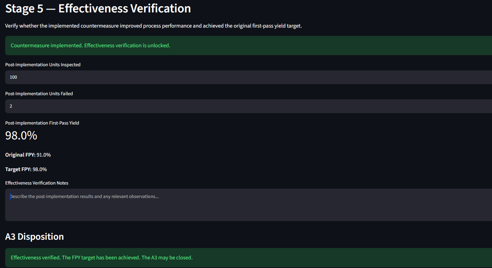

# Interactive A3 Continuous Improvement

An interactive Streamlit application demonstrating A3 problem-solving, root cause analysis, countermeasure development, and effectiveness verification using a synthetic medical-device manufacturing scenario.

🚀 **Live App:** [Launch the Interactive A3 Continuous Improvement App](https://interactive-a3-continuous-improvement-ctwpp7k9smpmaptayvphkl.streamlit.app/)

## Application Preview

## Overview

This project demonstrates how manufacturing quality concepts can be translated into an interactive Python workflow.

The application guides the user through a simplified A3 problem-solving process:

1. Define the problem and performance gap
2. Document the current condition
3. Perform Root Cause Analysis using the 5 Whys
4. Confirm the causal chain before developing countermeasures
5. Develop and implement a countermeasure
6. Verify effectiveness against the original First-Pass Yield (FPY) target
7. Determine whether the A3 can be closed or further investigation is required

All manufacturing scenarios and data used in this application are synthetic and are intended for educational and portfolio demonstration purposes.

## Key Features

- Interactive First-Pass Yield (FPY) performance-gap calculation
- Multiple synthetic medical-device scenarios
- Device-specific functional failure selection
- Inspection and failure-count validation
- Failure-rate calculation and leading-failure identification
- Interactive 5 Whys Root Cause Analysis
- Dynamic causal-chain prompts
- Analysis confirmation and change-control logic
- Countermeasure planning and implementation status
- Post-implementation FPY calculation
- Effectiveness verification against the original quality target
- Close / Continue Investigation disposition logic

## A3 Workflow

The application follows this simplified quality workflow:

**Problem → Current Condition → 5 Whys → Confirm Analysis → Countermeasure → Implementation → Effectiveness Verification → Close / Continue Investigation**

The workflow demonstrates an important continuous-improvement principle:

> Implementing a countermeasure does not prove effectiveness. Results must be verified against the original performance target.

## Example Scenario

A synthetic medical-device final assembly process has a target First-Pass Yield of **98%** but is currently operating at **91%**.

The application allows the user to investigate the performance gap, document observed failures, develop a 5 Whys causal chain, implement a countermeasure, and evaluate post-implementation results.

For example:

- Target FPY: 98%
- Original FPY: 91%
- Post-implementation inspection: 100 units
- Failed units: 2
- Post-implementation FPY: 98%

Because the post-implementation result meets the target, the application indicates that effectiveness has been verified and the A3 may be closed.

If the result remains below the target, the application directs the user to continue the investigation or revise the countermeasure.

## Quality Concepts Demonstrated

- A3 Problem Solving
- Root Cause Analysis
- 5 Whys
- First-Pass Yield (FPY)
- Performance Gap Analysis
- Inspection Data Validation
- Countermeasure Development
- Effectiveness Verification
- Continuous Improvement
- Change Control

## Technology

- Python
- Streamlit
- GitHub
- Streamlit Community Cloud

## Project Scope

This is a **V1.0 portfolio demonstration** designed to showcase the intersection of manufacturing quality and technology.

It is not intended to replace a formal quality management system, CAPA system, or validated electronic quality record.

The project uses synthetic scenarios and does not contain proprietary manufacturing or employer data.

## Author

**Marcus Faulkner**

Manufacturing Quality | Python | Data Analytics | Information Systems | Cybersecurity Learner
